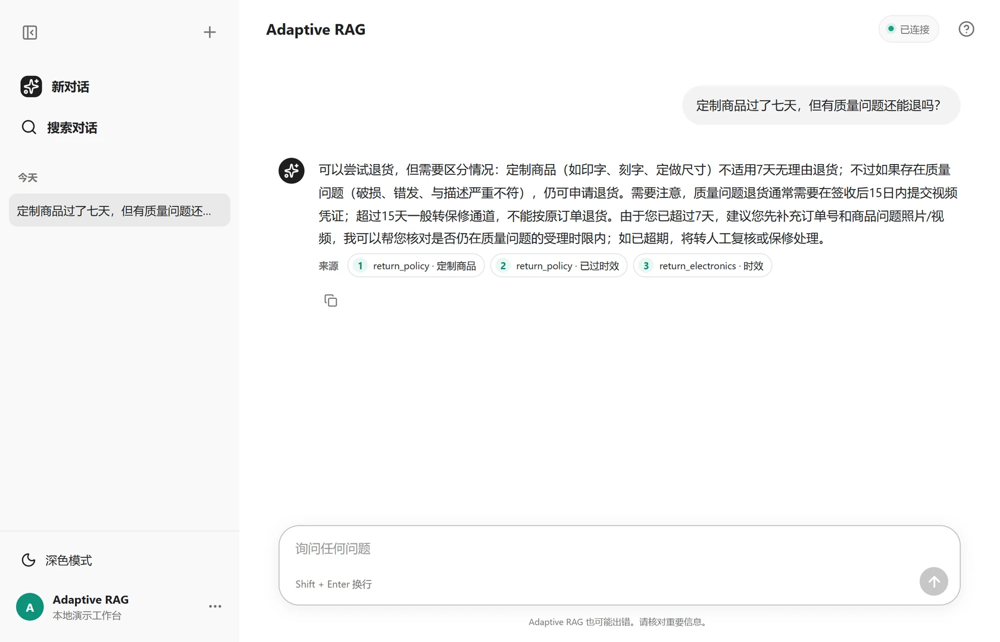
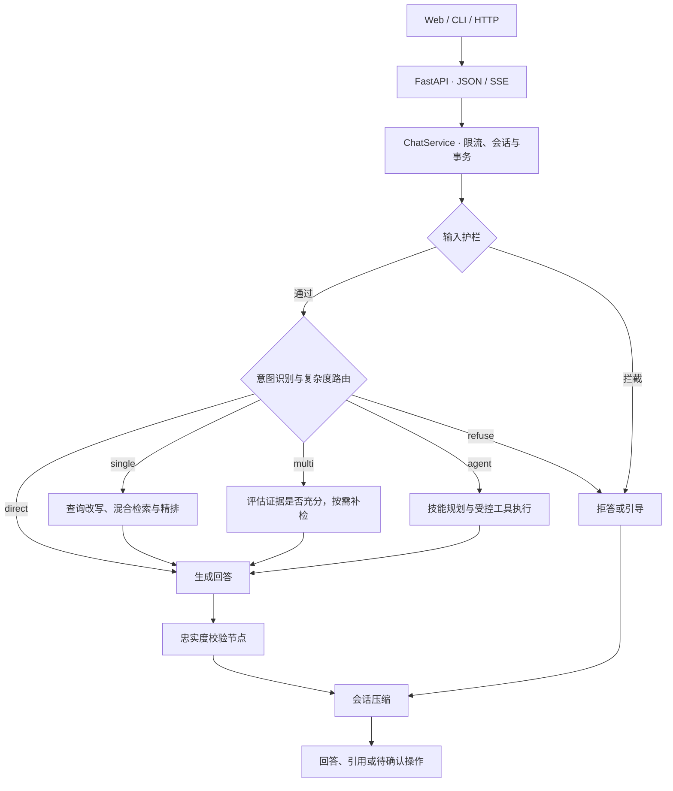
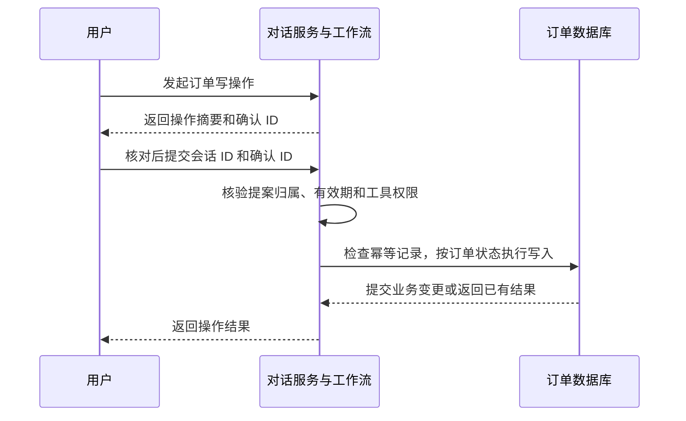

# Adaptive-RAG

**面向中文电商客服的检索增强问答与订单工作流**

Adaptive-RAG（2026.09–2026.10）针对传统 FAQ 难以覆盖长尾问题、复杂政策需要多条证据的场景，在同一套对话服务中处理**政策咨询、订单查询和售后操作**。LangGraph 根据意图和问题复杂度选择执行路径。政策回答附带条款出处，物流追问可接续同一会话中的订单，取消订单和发起退款等写操作需要用户确认后才会执行。

[](https://github.com/JJJJCCCCCCC/Adaptive-rag/actions/workflows/ci.yml) [](pyproject.toml) [](LICENSE)

[快速开始](#quickstart) · [系统架构](#architecture) · [评测结果](#evaluation) · [部署与开发](#deployment) · [文档](#docs)



*Web 工作台中的政策咨询示例。回答下方显示检索文档与对应章节。*

<a id="quickstart"></a>

## 快速开始

安装 Docker 和 Docker Compose 后，在终端运行以下命令。

```bash
git clone https://github.com/JJJJCCCCCCC/Adaptive-rag.git
cd Adaptive-rag
docker compose up --build -d
```

打开 [Web 工作台](http://127.0.0.1:8000) 或 [OpenAPI 文档](http://127.0.0.1:8000/docs)。默认配置使用 SQLite、内存缓存、BM25 与哈希向量，无需模型权重或 API 密钥。离线模式会摘录政策证据。加载演示订单后，也可查询订单与物流状态。在项目根目录的 `.env` 设置 `DEEPSEEK_API_KEY` 后，重新执行启动命令可启用生成式回答。密钥应保留在本地 `.env`。

```bash
curl -s http://127.0.0.1:8000/api/v1/chat \
  -H 'Content-Type: application/json' \
  -d '{"user_id":"u_demo","message":"定制商品过了七天，但有质量问题还能退吗？"}'
```

响应包含 `answer`、`strategy`、`session_id` 和 `trace_id`。政策回答可返回 `citations`，追问时可传回同一个 `session_id`。运行 `docker compose logs -f api` 查看日志，运行 `docker compose down` 停止服务。

<details>
<summary><strong>从源码启动并体验订单确认</strong></summary>

在仓库根目录运行以下命令，需要 Python 3.11+。种子脚本会向当前配置的数据库写入演示订单。保持 API 运行后，可在另一个终端运行 `python -m app.cli`。

```bash
python -m venv .venv
source .venv/bin/activate
python -m pip install -e ".[dev]"
test -f .env || cp .env.example .env
python -m scripts.seed_demo
uvicorn app.asgi:app --reload --port 8002
```

PowerShell 中使用 `.\.venv\Scripts\Activate.ps1` 激活虚拟环境，用 `if (-not (Test-Path .env)) { Copy-Item .env.example .env }` 初始化配置。下面的第二次请求会实际取消演示库中已支付、未发货的 `ORD10003`。重复运行种子脚本会保留已有订单状态。

```powershell
$uri = 'http://127.0.0.1:8002/api/v1/chat'
function Send-Chat($payload) {
    $request = @{
        Method = 'Post'
        Uri = $uri
        ContentType = 'application/json; charset=utf-8'
        Body = ($payload | ConvertTo-Json -Compress)
    }
    Invoke-RestMethod @request
}

$proposal = Send-Chat @{ user_id = 'u_demo'; message = '取消订单 ORD10003' }
$proposal.pending_action | Format-List action_id, tool_name, arguments, summary

# 核对提案后，单独执行以下确认请求。
if ($proposal.pending_action) {
    Send-Chat @{
        user_id = 'u_demo'
        session_id = $proposal.session_id
        message = '确认取消'
        confirm_action_id = $proposal.pending_action.action_id
    }
}
```

Web 开发模式在 `frontend/` 运行 `npm ci` 和 `npm run dev`，访问 [Vite 开发服务器](http://127.0.0.1:5173)。Vite 默认将 `/api` 代理到端口 `8002`。 [前端开发说明](frontend/README.md) · [完整启动指南](docs/02-getting-started.md)

</details>

<a id="architecture"></a>

## 系统架构

FastAPI 将 JSON 和 SSE 请求交给 `ChatService`。服务层负责限流、会话恢复和事务提交，LangGraph 负责路由与节点编排。文档索引、模型和工具由应用容器装配。



| 执行路径 | 请求示例 | 运行逻辑 |
| --- | --- | --- |
| `direct` | 「你好」 | 直接生成回答，跳过知识检索。 |
| `single` | 「电子发票多久能开？」 | 原问题与可用改写在同一轮召回候选，去重后精排。 |
| `multi` | 「优惠券和积分可以同时用吗？申请退款后怎么返还？」 | 评估已召回的证据，依据缺失方面改写查询，默认最多三轮。 |
| `agent` | 「查一下 ORD10001 的物流」 | 按意图和技能规划选用工具，执行参数、资源归属与风险检查。 |
| `refuse` | 超出客服业务范围的请求 | 由护栏或路由拒答，也可引导用户补充信息或转人工。 |

示例用于说明各条路径的用途，实际决策会随请求和模型配置变化。在线模式下，适用的回答会经过忠实度检查。核验失败时可改写并复核，或回退到证据摘录和拒答。流式接口先发送节点进度，再分段发送最终答案。React 按会话和消息 ID 更新回答，切换会话时取消在途请求。增量解码和帧缓冲处理 UTF-8 字符跨包、事件分隔符跨包及缺少结束符的末帧，由 Vitest 覆盖。 [前端会话处理](frontend/src/hooks/useChat.ts) · [SSE 测试](frontend/src/lib/sse.test.ts) [工作流源码](app/agents/graph.py) · [忠实度节点](app/agents/nodes/faithfulness.py) · [SSE 实录](eval/results/nov26/transports.json)

### 知识检索与证据补查

启动时加载知识文档，解析、清洗并切块。查询阶段由中文 BM25 和稠密向量分别召回，通过 RRF 融合候选，再由本地 Cross-Encoder 或词面排序进行精排。引用中保留文档标题、章节和片段 ID。默认知识目录含 **39 篇政策**，涵盖退换货、物流、发票和优惠等场景。 [知识库](knowledge/) · [检索实现](app/retrieval/) · [解析与检索说明](docs/15-ingest-and-retrieval.md)

**Evidence36 实录 H11。** 用户询问补配琥珀焖烧杯盖子的收费。首轮从售后说明找到了档位 `LX-218`，但还缺价格。启用实验性证据补检后，第二轮按档位查到《盖件备料账》，结合两份证据回答 **23 元**。同题固定单轮记录只确认了档位。实验开关 `EVIDENCE_GUIDED_RETRIEVAL` 默认关闭，启用后 `single` 和 `multi` 都可按证据充分性决定是否补检。 [双轮实录](eval/results/evidence36-live/H11-adaptive.json) · [单轮实录](eval/results/evidence36-live/H11-single.json) · [检索节点](app/agents/nodes/retrieval.py)

### 订单写入与用户确认

系统统一接入 **15 个业务工具**。取消订单、申请退款和申请退货需要二次确认。首轮写请求可返回带工具名、参数和操作摘要的 `pending_action`。再次请求时，服务按用户、会话和 15 分钟有效期核对确认 ID，执行器才可调用提案中的写工具。同一确认请求重试时，执行器按幂等键和参数指纹复用已完成的结果。取消订单和创建退款申请使用数据库条件更新校验状态，并在同一事务写入业务记录或审计信息。 [对话服务](app/services/chat_service.py) · [工具执行](app/agents/nodes/executor.py) · [订单仓储](app/repositories/order_repository.py)



<a id="evaluation"></a>

## 评测结果

### 120 题留出对照 · 按证据决定是否补检

在 12 个虚构商户的政策语料上，冻结 120 道留出题，包含 100 道可回答题和 20 道缺证据或域外对照。三组共享首轮召回、最终证据预算和 DeepSeek Flash 回答配置。可回答题须同时给对数值、单位和完整来源链。

| 检索策略 | 可回答题通过 | 全部用例通过 | 检索总轮数 | 总 Token |
| --- | ---: | ---: | ---: | ---: |
| 固定单轮 | 44/100 | 64/120 | 110 | 45,459 |
| 固定三轮 | 100/100 | 120/120 | 330 | 81,267 |
| **按证据补检** | **100/100** | **120/120** | **220** | **46,069** |

按证据补检比固定单轮多答全 **56 道**，商户聚类配对 95% 置信区间为 **+44.4 至 +66.7 个百分点**。相对固定三轮，它保持相同的通过题数，少检索 **110 轮**，按服务端回执计的 Token 减少 **43.3%**。这组结果来自带明确政策引用和结构化评分的受控检索组件，适用范围是本合成数据及模型配置。 [120 题报告与复算](eval/benchmarks/evidence120/README.md) · [历史 Evidence36](docs/25-evidence-guided-study.md)

### 检索和写入并发对照

| 验证项 | 样本与对照 | 结果 |
| --- | --- | --- |
| 历史完整检索方案 | 39 篇文档、65 道政策问题。BM25 对比 BM25 + BGE + RRF + 本地 Cross-Encoder。 | 首位命中率 P@1 **76.9% → 89.2%**。 [历史离线评测](eval/MEASURED.md) |
| 中文政策召回 | 65 道问题、39 篇政策。BM25 对比 BM25 + BGE-small 中文向量 + RRF。 | 首篇命中 **52/65 → 54/65**，文档 Recall@3 **90.0% → 94.6%**。本轮未加载 Cross-Encoder。 |
| 退款并发写入 | 四个独立进程同时对同一合成订单提交全额退款。 | SQLite 和 PostgreSQL 实际写入的退款申请均从 **4 条降到 1 条**。 |
| 确认请求重试 | SQLite 单实例连续三轮，每轮四次并发提交同一确认 ID。 | 每轮 **4/4 返回受理**，数据库均保留 **1 条退款申请**。 |

[检索逐题记录](eval/results/nov26/retrieval-local.json) · [并发报告](docs/21-experiment-results.md) · [应用层确认实测](eval/results/nov26/runtime.json) · [前一轮在线策略对照 Shop30](docs/24-shop30-evaluation.md)

常规离线检索可运行 `python -m eval.runner --task retrieval`。Evidence36 的在线复跑需要 DeepSeek 密钥，入口为 `python -m eval.evidence36`。 [评测方法与数据集](docs/10-evaluation.md) · [历史评测及配置](eval/MEASURED.md)

<a id="deployment"></a>
<a id="usage"></a>

## 部署与开发

| Compose 配置 | 服务组成 | 启动命令 |
| --- | --- | --- |
| 默认体验 | 单 API、SQLite、进程内缓存与向量索引 | `docker compose up --build -d` |
| 单机服务 | 单 API、PostgreSQL、Redis | `docker compose -f docker-compose.single.yml up --build -d` |
| 多实例拓扑 | 双 API、PostgreSQL、Redis、Qdrant、Nginx | `docker compose -f docker-compose.multi.yml up --build -d` |

单机和多实例配置需要在环境或 `.env` 中设置 `POSTGRES_PASSWORD`，默认启用本地 Embedding 与 Cross-Encoder，首次运行可能下载权重。源码环境可通过 `python -m pip install -e ".[rerank]"` 安装对应依赖。可选配置还包括 OpenAI 兼容 Embedding、Unstructured 文档解析和 Redis 检索缓存。 [配置参考](docs/07-configuration.md) · [部署手册](docs/11-deployment.md) · [环境变量模板](.env.example)

| 接口 | 用途 |
| --- | --- |
| `POST /api/v1/chat` · `POST /api/v1/chat/stream` | 完整 JSON 或 SSE。返回路由结果、引用、待确认操作与请求追踪信息。 |
| `GET /api/v1/health` · `GET /api/v1/ready` | 检查进程存活与数据库就绪，列出其他依赖状态。 |
| `GET /api/v1/capabilities` | 查看运行配置下的模型、检索与存储能力。 |
| `GET /metrics` | 导出 Prometheus 指标，包括请求量、分阶段耗时、工具结果和 Token。 |

<a id="limitations"></a>

> [!IMPORTANT]
> 对接真实用户前，需在可信 API 层认证并绑定用户身份。当前对话接口从请求体读取 `user_id`，订单和物流来自演示数据。待确认记录存于签发实例的内存，多实例部署时确认请求需回到签发实例。知识库在启动时全量摄取。 [API 参考](docs/06-api-reference.md) · [安全设计](docs/09-security.md) · [当前限制](docs/12-limitations.md)

<a id="dev"></a>

### 开发检查

CI 在 Python 3.11 和 3.12 上校验锁文件、格式、静态类型和后端测试。安装 `.[dev]` 后可运行以下检查。

```bash
uv lock --check
python -m ruff format --check .
python -m ruff check .
python -m mypy
python -m pytest -q --cov=app --cov=eval --cov-fail-under=70
```

`uv lock --check` 需要安装 uv。前端在 `frontend/` 运行 `npm ci` 后可执行 `npm test` 和 `npm run build`。 [CI 工作流](.github/workflows/ci.yml)

<a id="docs"></a>

## 项目结构与文档

源码快照含 **200 个源码文件、13,828 个非空行**。统计范围为下表目录中的 Python、TypeScript、TSX 和 CSS，含注释、迁移和测试，排除文档、锁文件、评测数据和静态资源。 [统计所用提交 `5baa0f8`](https://github.com/JJJJCCCCCCC/Adaptive-rag/tree/5baa0f87fa8f2effc9b097c9ec0c2ba9d85f1c2b)

| 目录 | 文件数 | 职责 |
| --- | ---: | --- |
| [`app/`](app/) | 120 | API、Graph 节点、检索管线、工具、数据仓储、模型适配与可观测性 |
| [`frontend/src/`](frontend/src/) | 16 | React 对话工作台、SSE 消费、引用展示与确认卡片 |
| [`eval/`](eval/) | 21 | 离线评测、在线策略对照、证据回放与并发实验 |
| [`tests/`](tests/) | 35 | 单元、检索与订单集成、HTTP 端到端测试 |
| [`alembic/`](alembic/) · [`scripts/`](scripts/) | 8 | 数据库迁移、种子数据和开发辅助脚本 |

源码入口依次为 [FastAPI 应用工厂](app/main.py)、[依赖装配](app/services/container.py)、[对话服务](app/services/chat_service.py) 和 [LangGraph 工作流](app/agents/graph.py)。 [完整文档索引](docs/README.md) · [架构说明](docs/03-architecture.md) · [工具及技能设计](docs/05-agents-and-tools.md) · [可靠性](docs/08-reliability.md)

<a id="contributing"></a>

问题报告和代码贡献可参考 [贡献指南](CONTRIBUTING.md)。

<a id="license"></a>
<a id="credits"></a>

## 许可证与参考

本项目采用 [MIT 许可证](LICENSE)。复杂度路由和证据反思的设计分别参考 Jeong 等人的 Adaptive-RAG 与 Asai 等人的 Self-RAG。 [Adaptive-RAG 论文](https://aclanthology.org/2024.naacl-long.389/) · [Self-RAG 论文](https://arxiv.org/abs/2310.11511)
