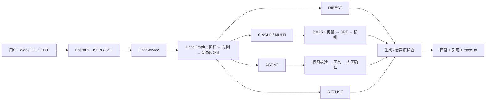

# Adaptive-RAG 电商智能客服

[](https://github.com/JJJJCCCCCCC/Adaptive-rag/actions/workflows/ci.yml) [](pyproject.toml) [](pyproject.toml) [](LICENSE)

Adaptive-RAG 是一个可在本地运行的中文电商客服示例。它用 LangGraph 将问题路由到不同流程：问候直接回答，政策咨询检索并引用条款，取消订单或申请退款则先展示操作摘要，等用户确认后再写入数据库。

本项目面向首次搭建 RAG 应用的开发者，以及希望接入客服 API、比较检索策略或验证业务工具流程的工程师。后端使用 Python、FastAPI 与 SQLAlchemy，前端使用 React、TypeScript 与 Vite。

## 目录

[核心功能](#overview) · [快速开始](#quickstart) · [配置与 API](#usage) · [系统架构](#architecture) · [开发与测试](#dev) · [评测](#evaluation) · [项目结构与文档](#docs) · [使用边界](#limitations) · [贡献方式](#contributing) · [许可证](#license) · [致谢](#credits)


<a id="overview"></a>

## 核心功能

> **Adaptive RAG** 的核心决策是：这个问题需要直接回答、检索一条证据、交叉核对多条证据、调用业务工具，还是拒绝处理？

电商客服里的问题跨度很大。「你好」无需查知识库；退货政策需要可靠出处；「定制商品超过七天但有质量问题」要同时判断定制、时效与质量例外；取消订单则必须检查订单状态、权限与确认。项目用明确的路由策略处理这些差异，避免把所有输入都塞进同一条向量检索链路。

| 能力 | 你能看到什么 | 关键实现 |
|:---|:---|:---|
| **按复杂度路由** | 每次回答带有 `strategy`，便于追踪实际路径 | [Graph 与节点](app/agents/graph.py) · [策略枚举](app/core/enums.py) |
| **有出处的检索** | BM25、稠密向量、RRF 融合与精排；回答可带 `citations` | [检索模块](app/retrieval/) |
| **多跳与自纠错** | 复合问题拆分检索，答案经过忠实度检查 | [智能体节点](app/agents/nodes/) |
| **人工确认** | 高风险写操作先返回 `pending_action`，确认后才执行 | [工具与权限](app/tools/) |
| **Web 对话工作台** | 流式显示、引用、本地会话搜索、深色模式与确认卡片 | [前端](frontend/) |
| **可测可观测** | 离线评测、回归测试、结构化日志与 Prometheus 指标 | [评测](eval/) · [可观测性](app/observability/) |

### 五条处理路径

| 策略 | 适合的问题 | 处理方式 |
|:---:|:---|:---|
| `DIRECT` | 问候、闲聊 | 直接生成，不做知识检索 |
| `SINGLE` | 单一政策问题 | 一轮混合检索与精排 |
| `MULTI` | 多条件、跨条款问题 | 查询改写、多路检索与自纠错 |
| `AGENT` | 查询订单、物流或发起业务操作 | 规划后调用受权限约束的工具 |
| `REFUSE` | 越权、注入或证据不足 | 拒答或引导人工处理 |


<a id="quickstart"></a>

## 🚀 快速开始

### 🐳 Docker 部署

需要 Docker 和 Docker Compose。以下命令均在项目根目录执行。

#### 1. 默认演示

适合快速体验，使用 SQLite、BM25 和内存缓存 / 向量库，不需要 PostgreSQL、Redis、Qdrant 或外部 API 密钥。

```powershell
docker compose up --build -d
```

#### 2. 单机生产

使用 PostgreSQL、Redis 和单个 API 实例。先设置数据库密码：

```powershell
$env:POSTGRES_PASSWORD="your-password"
docker compose -f docker-compose.single.yml up --build -d
```

#### 3. 多实例生产

使用 PostgreSQL、Redis、Qdrant、两个 API 实例和 Nginx 负载均衡：

```powershell
$env:POSTGRES_PASSWORD="your-password"
docker compose -f docker-compose.multi.yml up --build -d
```

单机和多实例模式建议配置 `DEEPSEEK_API_KEY` 以启用生成式回答。启用本地 Embedding / Cross-Encoder 时，首次构建和启动可能下载模型，需要预留较大的磁盘和内存。

启动后访问 **http://127.0.0.1:8000**；API 文档见 **http://127.0.0.1:8000/docs**；健康检查见 **http://127.0.0.1:8000/api/v1/health**。

查看日志或停止服务：

```powershell
docker compose logs -f api
docker compose down
```

单机和多实例模式使用对应的 `-f` 参数执行 `logs` 和 `down`。没有 `DEEPSEEK_API_KEY` 时，系统使用离线证据回答；Redis、Qdrant、Embedding 或 Cross-Encoder 不可用时，会按代码中的降级策略继续运行。

不使用 Docker 时，需要 **Python 3.11+**；Web 开发另需满足[前端 Node.js 要求](frontend/README.md)。

### 1. 安装并启动 API

```bash
git clone https://github.com/JJJJCCCCCCC/Adaptive-rag.git
cd Adaptive-rag
python3 -m venv .venv
source .venv/bin/activate
pip install -e ".[dev]"
cp -n .env.example .env
uvicorn app.asgi:app --reload --port 8002
```

Windows PowerShell 激活虚拟环境可使用 `.venv\Scripts\Activate.ps1`。首次启用本地 Embedding / Cross-Encoder 时可能需要下载模型；需要完整的本地精排依赖可安装 `pip install -e ".[rerank]"`。更多选项见[配置参考](docs/07-configuration.md)。

`.env` 中的 `DEEPSEEK_API_KEY` 可留空：此时系统进入离线演示模式，展示检索原文或可核对的订单状态，不会假装生成完整答案。要体验生成式回答，需要配置可用的 DeepSeek 密钥。**不要提交 `.env` 或密钥。**

### 2. 发送第一条消息

```bash
curl -s http://127.0.0.1:8002/api/v1/health
curl -s http://127.0.0.1:8002/api/v1/chat \
  -H 'content-type: application/json' \
  -d '{"message":"定制马克杯过了七天，但有质量问题还能退吗？","user_id":"u_demo"}'
```

响应包含 `answer`、`strategy`、`trace_id`，需要检索时还会带 `citations`。也可以运行 `python -m app.cli` 进入终端对话；流式接口为 `POST /api/v1/chat/stream`，完整字段见 [API 参考](docs/06-api-reference.md)。

### 3. 打开 Web 工作台

保持 API 运行，另开终端：

```bash
cd frontend
npm ci
npm run dev
```

访问 **http://127.0.0.1:5173**。开发服务器会把 `/api` 代理到本地 FastAPI。执行 `npm run build` 后，FastAPI 检测到 `frontend/dist` 也会在根路径提供页面；Docker 镜像会自动构建前端。前端会话列表存于浏览器本地，详见[前端 README](frontend/README.md)。


<a id="usage"></a>

## 配置与 API 使用指南

源码运行时在根目录的 `.env` 中设置参数，修改后重启 API。Compose 显式设置的变量以对应 Compose 文件为准。

| 配置项 | 用途 |
| --- | --- |
| `KNOWLEDGE_DIR` | 默认为 `knowledge`。修改 Markdown 政策文件后，重启服务以重新摄取文档。 |
| `DEEPSEEK_API_KEY`、`DEEPSEEK_MODEL` | 设置密钥后可调用 DeepSeek。留空时可体验基于已有条款和业务状态的回复。 |
| `DATABASE_URL` | 本地示例使用 SQLite。种子脚本和 API 应指向同一数据库。 |
| `LOCAL_EMBEDDING_ENABLED`、`CROSS_ENCODER_ENABLED` | 控制本地 BGE 召回与重排。使用前安装 `python -m pip install -e ".[rerank]"` 并准备模型权重。 |
| `MAX_RETRIEVAL_HOPS` | 多轮检索上限，示例值为 3。 |
| `REDIS_URL`、`QDRANT_URL` | 可选缓存与向量库地址。通过能力接口检查实际启用的后端。 |

完整配置见 [环境变量模板](.env.example) 和 [配置参考](docs/07-configuration.md)。

| 接口 | 用途 |
| --- | --- |
| `POST /api/v1/chat` | 返回一轮对话的完整 JSON。 |
| `POST /api/v1/chat/stream` | 通过 SSE 接收处理进度与回答事件。 |
| `GET /api/v1/health`、`GET /api/v1/ready` | 检查进程存活及服务就绪状态。 |
| `GET /api/v1/capabilities` | 查询当前生成、检索和存储后端。 |

**在 PowerShell 中体验订单确认。** 源码模式先在项目根目录运行 `python -m scripts.seed_demo`。脚本为 `u_demo` 创建演示订单，其中 `ORD10003` 初始为已支付、未发货。

```powershell
$uri = 'http://127.0.0.1:8002/api/v1/chat'
function Send-Chat($payload) {
    Invoke-RestMethod -Method Post -Uri $uri -ContentType 'application/json; charset=utf-8' -Body ($payload | ConvertTo-Json)
}
$order = Send-Chat @{ user_id = 'u_demo'; message = '取消订单 ORD10003' }
$order.pending_action | Format-List action_id, tool_name, arguments, summary
```

核对摘要后，如需实际取消该演示订单，传回同一会话 ID 和操作 ID：

```powershell
if ($order.pending_action) {
    Send-Chat @{
        user_id = 'u_demo'
        session_id = $order.session_id
        message = '确认取消'
        confirm_action_id = $order.pending_action.action_id
    }
}
```

政策问答可读取 `answer`、`strategy` 和 `citations` 核对回答与来源。追问时传回 `session_id`，排查单次请求时使用 `trace_id`。详见 [API 参考](docs/06-api-reference.md)。

<a id="dev"></a>

## 开发与测试

在项目根目录激活已安装 `.[dev]` 的虚拟环境。以下检查与 [CI 工作流](.github/workflows/ci.yml) 对应：

```bash
python -m ruff format --check .
python -m ruff check .
python -m mypy
python -m pytest -q --cov=app --cov=eval --cov-fail-under=70
```

前端使用 Node.js 20.19+（20.x）或 22.12+。在 `frontend/` 下运行 `npm ci` 安装锁定依赖，`npm test` 执行测试，`npm run build` 生成 `frontend/dist`。后端启动后可从根路径提供构建好的页面。


<a id="architecture"></a>

## 🏗️ 系统架构



HTTP 层处理校验与序列化，`ChatService` 编排对话，Graph 决定路径，检索器与工具由容器装配。默认数据库为 SQLite；Redis、Qdrant 和远程模型按配置接入。完整的节点、降级路径和依赖关系见[架构与运行流程](docs/17-architecture-flow.md)。


<a id="evaluation"></a>

## 📊 实测结果与口径

下面的**检索与生成指标**来自 2026-08-22 的离线评测，具体数据集、模型与运行命令见 [`eval/MEASURED.md`](eval/MEASURED.md) 和[完整报告](docs/14-evaluation-report.md)。报告原始 JSON 未随仓库分发，复现时应以当前环境重新运行。

| 环节 | 样本与设置 | 结果 |
|:---|:---|:---|
| 意图识别 | 100 条，`intent_v3` + 歧义规则覆盖 | **100%**；纯模型结果并非 100% |
| BM25 稀疏检索 | 65 条政策问题 / 39 篇文档 | P@1 **76.9%** · R@3 **90.0%** |
| bge-small 稠密检索 | 同一检索集 | P@1 **83.1%** · R@3 **94.6%** |
| Hybrid + Cross-Encoder | 同一检索集 | P@1 **89.2%** · R@3 **97.7%** · MRR **0.94** |
| RAG + 自纠错生成 | 65 条，同模型裁判 | 忠实度 **100%** · 幻觉率 **0%** |
| 端到端 | 16 条 | 关键词命中 **9/11** · P50 **4.9s** · P95 **5.8s** |

> [!IMPORTANT]
> 这些是**指定离线集合与模型配置**下的测量值，不代表生产环境承诺。该集合上 RRF 与单独使用 bge-small 的检索数字相同，主要增益来自 Cross-Encoder；生成忠实度使用同模型裁判，可能偏乐观。不要把 `0%` 幻觉率理解为真实场景零错误。

CI 在 Python 3.11 / 3.12 上检查锁文件、Ruff、mypy 和 pytest；[查看工作流](.github/workflows/ci.yml)。本地可运行：

```bash
python -m pytest -q
python -m eval.runner --task retrieval
cd frontend && npm test && npm run build
```

Windows PowerShell 在项目根目录使用下面两条命令，无需激活环境，避免调用系统中其他版本的 Python：

```powershell
.\.venv\Scripts\python.exe -m pytest -q
.\.venv\Scripts\python.exe -m eval.runner --task retrieval
```

若提示找不到 `pytest` 或 `eval`，先确认当前位置包含 `pyproject.toml` 和 `.venv`。检索评测提示 `local_embedding_sdk_missing` 或 `cross_encoder_sdk_missing` 时，会使用后备检索并在报告中标注，不表示评测失败；完整本地模型评测需要安装 `.[rerank]` 并成功加载模型权重。


- **修复并发退款与重复确认。** 将退款资格校验和订单状态变更合并为一条数据库条件更新，并在同一事务中写入退款申请。用 4 个独立进程同时对同一笔测试订单申请退款，SQLite 和 PostgreSQL 中的申请记录均由 **4 条降至 1 条**。对同一确认请求按幂等键和参数指纹回放结果，单实例连续 3 轮并发复测中，每轮 4 个请求均得到受理回复，且只生成 1 条申请。
- **评估客服意图识别。** 构造覆盖 14 类意图的 28 条新问法，区分退款进度查询、退货申请、物流查询等易混场景。在同一批题上，现有离线规则判对 **6/28**，实际调用 DeepSeek 单独分类判对 **28/28**，叠加规则纠偏后结果持平。
- **优化政策检索。** 针对用户口语与条款措辞不一致的问题，用 BM25 和中文 BGE 双路召回，以 RRF 融合排序。在 39 篇政策、65 道问题的离线对照中，相比纯 BM25，混合召回将首篇命中从 **52/65 提至 54/65**，前三篇文档召回率从 **90.0% 提至 94.6%**。
- **实现并验证按需检索。** 对涉及多项条件的问题，根据缺失证据改写查询，最多补检至第 3 轮。使用真实 DeepSeek 在隔离知识库对比固定单轮、固定三轮和自适应策略，通过逐题核对路由、检索记录和最终回答，定位到两次可回答问题在检索前被误拒的情况。

[检索与并发实验](docs/21-experiment-results.md) · [DeepSeek 在线补测](docs/23-deepseek-live.md)


<a id="docs"></a>

## 项目结构与文档

| 目标 | 推荐入口 |
|:---|:---|
| 跑通 API、CLI、Web 与 Docker | [快速开始](docs/02-getting-started.md) · [部署](docs/11-deployment.md) |
| 理解分层、Graph 与路由 | [架构](docs/03-architecture.md) · [Adaptive RAG](docs/04-adaptive-rag.md) |
| 看检索、精排、工具与 HITL | [解析与检索](docs/15-ingest-and-retrieval.md) · [智能体与工具](docs/05-agents-and-tools.md) |
| 查接口、配置、安全与可靠性 | [API](docs/06-api-reference.md) · [配置](docs/07-configuration.md) · [安全](docs/09-security.md) · [可靠性](docs/08-reliability.md) |
| 核对实验口径与数字 | [评测方法](docs/10-evaluation.md) · [原始数字说明](eval/MEASURED.md) |
| 系统学习 RAG 工程实践 | [12 部分教学文档](docs/tutorial/README.md) |
| 准备 Agent/RAG 面试 | [Chapter 1](docs/interview/chapter1.md) · [Chapter 2](docs/interview/chapter2.md) · [Chapter 3](docs/interview/chapter3.md) · [17 维度索引](docs/16-interview-bagu-map.md) |

完整索引见 [`docs/README.md`](docs/README.md)。源码可从 `app/asgi.py` → `app/services/chat_service.py` → `app/agents/graph.py` 开始读；Web 代码在 `frontend/src/`。

<details>
<summary><strong>📁 展开项目目录</strong></summary>

```text
app/
  api/            HTTP 路由、校验、SSE
  services/       ChatService、依赖容器、演示数据
  agents/         LangGraph 状态机与节点
  retrieval/      解析、切块、混合检索、精排与自纠错
  tools/          业务工具、注册表与权限
  repositories/   订单、会话与幂等
  providers/      生成、Embedding 与 Rerank
  guardrails/     注入、边界与忠实度检查
  memory/         上下文预算与压缩
  observability/  日志、指标与请求上下文
frontend/         React + TypeScript Web 工作台
knowledge/        政策文档
eval/             离线评测与口径
tests/            单元、集成与端到端测试
docs/             技术手册与教学文档
```

</details>

<a id="limitations"></a>

## ⚠️ 使用边界

这是可运行的工程示例，**目前不应直接面向不可信用户开放**：

- API 尚未认证请求中的 `user_id`；前端默认 `u_demo` 仅供本地演示。部署前应由可信服务端认证并绑定身份。
- 订单与物流来自本地仓储演示数据，没有连接真实承运商或支付网关。
- Web 会话列表保存在当前浏览器的 `localStorage`，清除站点数据或换设备后不会恢复。
- 知识库启动时全量 ingest，尚无增量删除接口；Embedding / 精排权重不可用时会降级，降级后的效果未单独评测。

更多实现边界与后续方向见[限制与路线图](docs/12-limitations.md)。


<a id="contributing"></a>

## 贡献方式（Contributing）

报告问题时请附复现步骤、运行方式和预期行为。提交修改时从独立分支发起 Pull Request，说明涉及的模块及验证结果。依赖变更请同步更新 `pyproject.toml` 与 `uv.lock`，用 `uv lock --check` 校验。详见 [贡献指南](CONTRIBUTING.md)。

<a id="license"></a>

## 许可证（License）

本项目采用 [MIT 许可证](LICENSE)。

<a id="credits"></a>

## 致谢（Acknowledgements）

感谢 FastAPI 和 LangGraph 提供 HTTP 服务与图编排基础，jieba 和 rank-bm25 提供中文分词与关键词检索能力，BAAI 的 BGE 系列提供可选向量和重排模型，以及 React 和 Vite 提供 Web 工作台的开发工具。
